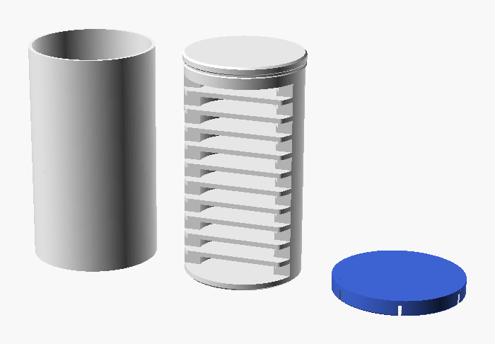

# Accessories for Battery Daddy

3D-printable accessories for the **Battery Daddy** battery organizer case. The first one is a coin-cell sleeve: a "sleeve of cookies" that holds button and coin cells and drops into an AA or D slot.



> Battery Daddy is a trademark of Ontel Products Corporation. This is an independent project. It is not affiliated with, sponsored by or endorsed by Ontel.

## Coin-cell sleeves

Each sleeve has three parts:

- A **tube** that fits the case slot.
- A **cartridge** that slides into the tube. Each cell sits in its own pocket, and shelves keep the cells from touching.
- A snap-on **cap** with the cell name in a second color, so you can read it through the clear lid.

To use it, pull the sleeve out, tip out one cell and put it all back.

| Cell | Also sold as | Slot | Cells per sleeve | Status |
|---|---|---|---|---|
| LR44 | AG13, 357, A76 | AA | 6 | Printed and confirmed |
| LR621 | AG1, 364 | AA | 11 | Printed and confirmed |
| LR754 | AG5, 393 | AA | 6 | Printed and confirmed |
| CR1620 | | D | 15 | Printed and confirmed |
| CR2032 | | D | 11 | Printed and confirmed |
| CR2025 | | D | 13 | Printed and confirmed |

### Download

Ready-to-print files are on the [Releases](../../releases) page:

- Bambu Studio plates (`.3mf`): the cap text is already set to filament 2.
- Plain STLs for any slicer.

They are also on [MakerWorld](https://makerworld.com/en/models/3673397-coin-cell-sleeves-for-battery-daddy-lr44-621-754) (LR44, LR621 and LR754, with ready-to-print Bambu profiles).

### Printing

- Print at **100% scale**. The fits are tuned on real prints, so scaling breaks them.
- Use a 0.4 mm nozzle; PLA works fine.
- **Tube:** print upright.
- **Cartridge:** print lying on its back (the flat side). A brim helps.
- **Cap:** print face-down. Body is color 1 and text is color 2. For a single-color printer, pause at the layer change or just print one color.
- The tube wall is 0.7 mm or more, so the slicer prints it true. Don't let your slicer "fix" thin walls.

### Customize

Everything comes from one parametric OpenSCAD file, [`coin-cell-sleeve/battery_daddy_coin_sleeve.scad`](coin-cell-sleeve/battery_daddy_coin_sleeve.scad).

1. Open it in [OpenSCAD](https://openscad.org/).
2. Set `cell` to one of the presets and `part` to `"tube"`, `"core"` (cartridge), `"cap_body"`, `"cap_text"` or `"assembly"`.
3. Render with F6 and export to STL.

From the command line:

```sh
openscad -o CR2032_tube.stl -D 'cell="CR2032"' -D 'part="tube"' coin-cell-sleeve/battery_daddy_coin_sleeve.scad
```

To build every sleeve, with STLs and Bambu 3MF plates plus mesh checks:

```sh
pip install trimesh numpy
python3 tools/build_all.py            # or: python3 tools/build_all.py CR2032
```

The label font is **DejaVu Sans Bold**. Install it if OpenSCAD can't find it (on macOS: `brew install --cask font-dejavu`).

**Adding a cell:** add a row to `presets` (name, max diameter, max thickness, slot, label lines and letter height) and to `CELLS` in `tools/build_all.py`. The cell count is calculated automatically.

### How it fits

The Battery Daddy slots vary from slot to slot and narrow toward the bottom. The numbers in the model come from test prints on a Bambu X1C:

| | AA slot | D slot |
|---|---|---|
| Tube OD | 14.23 mm | 32.97 mm |
| Tube wall | 0.708 mm | 0.905 mm |
| Cartridge-to-tube gap (radial) | 0.2145 mm | 0.229 mm |
| Total height | 50.3 mm | 61.3 mm |

If your sleeves are tight or loose, see [docs/coin-cell-sleeves.md](docs/coin-cell-sleeves.md) for how the fit was tuned. To change the outside diameter, move the tube ID and the cartridge with it, so the friction gap stays the same.

## Repository layout

```
coin-cell-sleeve/   parametric OpenSCAD model (the source of truth)
tools/              make3mf_tool.py (Bambu 3MF writer), build_all.py (render + check everything)
docs/               design notes, case measurements, change log, early history
images/             renders for this README
.github/workflows/  builds every sleeve on each push; attaches files to tagged releases
```

## Contributing

Remixes, new cell sizes and fit reports are welcome. Open an issue or a pull request. For fit reports, please include your printer, your filament and the measured OD.

## License

- **Designs** (`.scad` models, generated STL/3MF files, images and docs): [CC BY-SA 4.0](LICENSE). You may share and remix them, including commercially, as long as you give credit and release remixes under the same license.
- **Tools** (`tools/*.py`): [MIT](tools/LICENSE).

© 2026 Chris Denney
